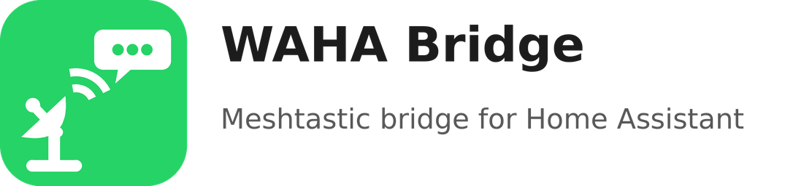
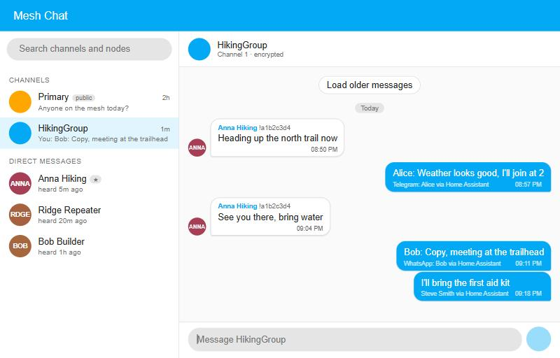
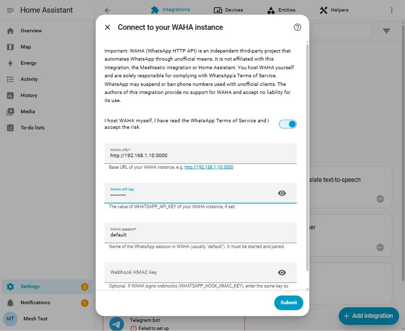
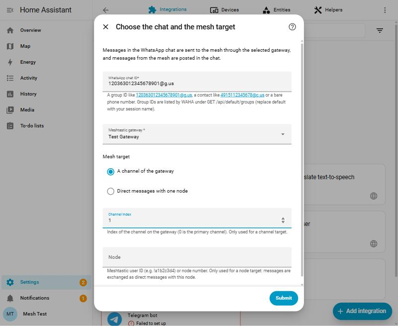
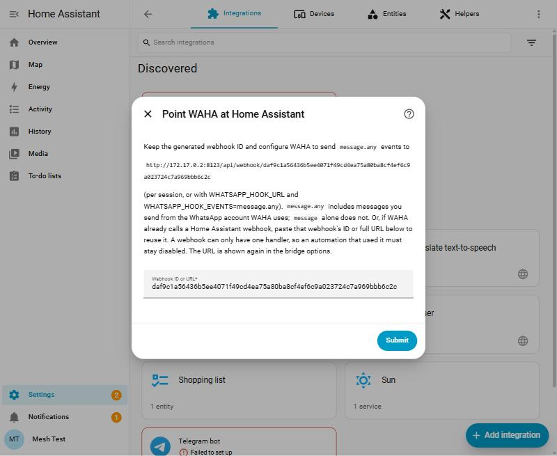

<p align="center"></p>

# Meshtastic WAHA Bridge

A Home Assistant integration that links a **WhatsApp chat** with a **Meshtastic channel or node**, using a
[WAHA](https://waha.devlike.pro) (WhatsApp HTTP API) instance that **you host yourself** and the
[Meshtastic integration](https://github.com/meshtastic/home-assistant).

> ## Please read before installing
>
> WAHA is an independent third-party project that automates WhatsApp through **unofficial** means (it drives a
> WhatsApp Web session). It is not affiliated with, endorsed by or supported by this integration, the Meshtastic
> integration, Meshtastic or Home Assistant.
>
> - You install, run and secure WAHA yourself. This integration only talks to a WAHA instance you point it at.
> - Automating WhatsApp with unofficial clients is against
>   [WhatsApp's Terms of Service](https://www.whatsapp.com/legal/terms-of-service). WhatsApp may suspend or
>   **ban the phone number** you use. Use a number you can afford to lose.
> - By enabling this integration you confirm that you have read the terms and accept this risk. The authors of this
>   integration accept no liability and provide no support for WAHA itself.
>
> If you need an officially supported WhatsApp channel, look at the WhatsApp Business Cloud API instead. It has
> different constraints (templates, 24 hour reply windows) that this integration does not cover.

- Messages written in the WhatsApp chat are sent over the mesh by your gateway, as `Bob: on my way`.
- Messages received over the mesh are posted in the WhatsApp chat, as **📡 Anna Hiking**: on my way.
- Messages sent from Home Assistant (the Mesh Chat panel, automations, another bridge) are posted too, shown as
  coming from the gateway node, exactly as other mesh users see them.
- One bridge links one chat (group or contact) with one channel (or one node for direct messages). Add the
  integration again for more.

<p align="center"></p>

## Contents

1. [How it works](#how-it-works)
2. [Requirements](#requirements)
3. [Installation](#installation)
4. [Setup, step by step](#setup-step-by-step)
5. [Options](#options)
6. [What the messages look like](#what-the-messages-look-like)
7. [Limits and risks](#limits-and-risks)
8. [Troubleshooting](#troubleshooting)
9. [Removing the bridge](#removing-the-bridge)

## How it works

| Direction | Source | Target |
|---|---|---|
| WhatsApp → mesh | WAHA posts `message.any` events to a Home Assistant **webhook** (optionally HMAC signed) | `meshtastic.send_text` action of the Meshtastic integration |
| Mesh → WhatsApp | `meshtastic_api_text_message` event (received over the radio) and `meshtastic_chat_message_sent` event (sent from Home Assistant) | WAHA's `POST /api/sendText` |

The bridge stores the WAHA URL, API key and optional webhook signing key in its config entry, like any other
integration. The gateway connection stays in the Meshtastic integration.

## Requirements

| Dependency | Needed for | Notes |
|---|---|---|
| Home Assistant 2025.7 or newer | | older versions are not supported |
| [Meshtastic integration](https://github.com/meshtastic/home-assistant) with a gateway | sending and receiving on the mesh | any version works for radio messages |
| Meshtastic integration, **Mesh Chat test build 5** or newer | showing bridged messages in the Mesh Chat panel and mirroring messages sent from Home Assistant | install from [rdkmedia0/home-assistant](https://github.com/rdkmedia0/home-assistant/releases) through HACS |
| A running [WAHA](https://waha.devlike.pro) instance (Core or Plus) | talking to WhatsApp | with a paired session, able to reach Home Assistant's webhook URL |
| A WhatsApp account for WAHA | | your own number works; see the risks above |

## Installation

### With HACS (recommended)

1. HACS → ⋮ (top right) → **Custom repositories**.
2. Repository: `https://github.com/rdkmedia0/meshtastic-waha-bridge`, type: **Integration**, add.
3. Search HACS for **Meshtastic WAHA Bridge**, download the latest version.
4. Restart Home Assistant.

### Manually

Copy the folder `custom_components/meshtastic_waha_bridge` of this repository into the `custom_components`
folder of your Home Assistant configuration and restart Home Assistant.

## Setup, step by step

### 1. Run WAHA

Follow WAHA's own documentation. A minimal example with the settings this bridge relies on (check the WAHA docs for
the current image name and options):

```bash
docker run -d --name waha -p 3000:3000 \
  -e WHATSAPP_API_KEY=change-me \
  -e WHATSAPP_HOOK_URL=https://your-home-assistant/api/webhook/<id-from-step-3> \
  -e WHATSAPP_HOOK_EVENTS=message.any \
  -e WHATSAPP_HOOK_HMAC_KEY=change-me-too \
  devlikeapro/waha
```

- Subscribe to **`message.any`**, not just `message`: only `message.any` includes messages you send from the phone
  WAHA is logged in as.
- The webhook can also be configured per session through WAHA's API (`config.webhooks`), which allows several
  webhooks at once.
- Start the session (usually `default`) and pair it by scanning the QR code in WAHA's dashboard.

### 2. Find the WhatsApp chat ID

- Groups: WAHA lists them under `GET /api/default/groups` (replace `default` with your session name), in the
  Swagger UI at your WAHA URL. IDs end in `@g.us`, e.g. `120363012345678901@g.us`.
- A contact: the phone number without `+` followed by `@c.us`, e.g. `4915112345678@c.us`. A bare number is accepted.

### 3. Add the bridge

Settings → Devices & services (called **Devices** in newer versions) → **Add integration** →
*Meshtastic WAHA Bridge*. The setup has three steps.

**Step 1, connection.** Read the notice and confirm it, then enter where WAHA runs.

<p align="center"></p>

| Field | What to enter |
|---|---|
| Acknowledgement | must be on to continue |
| WAHA URL | the base URL only, e.g. `http://192.168.1.10:3000`. The bridge adds `/api/...` itself |
| WAHA API key | the value of `WHATSAPP_API_KEY`, if set |
| WAHA session | the session name, usually `default` |
| Webhook HMAC key | optional. The value of `WHATSAPP_HOOK_HMAC_KEY` if WAHA signs its webhooks. Unsigned calls are then rejected |

The bridge checks the session at this point. "Session does not exist" means the name is wrong or the session was
never created; "could not be reached" means the URL or network.

**Step 2, chat and mesh target.**

<p align="center"></p>

| Field | What to enter |
|---|---|
| WhatsApp chat ID | the group or contact ID from step 2 |
| Meshtastic gateway | the gateway whose channel or node is bridged |
| Mesh target | **A channel of the gateway** or **Direct messages with one node** |
| Channel index | 0 is the primary channel, 1 the first secondary channel. Only for a channel target |
| Node | only for a node target: user ID (`!a1b2c3d4`) or node number. Leave empty for a channel |

**Step 3, webhook.** Home Assistant generates a webhook for WAHA to call.

<p align="center"></p>

- Keep the generated ID and copy the URL into WAHA (`WHATSAPP_HOOK_URL`, or the session's webhook config), **or**
- paste the ID or full URL of a Home Assistant webhook WAHA already calls to reuse it. A webhook has one handler,
  so an automation that used it must stay disabled.

The URL contains Home Assistant's external address if one is configured. WAHA on the same network can use the
internal address instead; only the host part matters. The URL is shown again under the bridge's **Configure**.

Submit, then test: write in the WhatsApp group, it appears in the Mesh Chat panel and goes out over the radio;
send from a node on that channel, it appears in the group.

## Options

Open the bridge's entry → **Configure**.

| Option | Default | Description |
|---|---|---|
| Direction | Both | Only forward WhatsApp to the mesh, only the mesh to WhatsApp, or both |
| Prefix mesh messages with the WhatsApp sender's name | on | `Bob: on my way` on the mesh (name cut to 24 characters) |
| Prefix WhatsApp messages with the mesh node's name | on | **📡 Anna Hiking**: on my way in WhatsApp |
| WhatsApp messages longer than 200 bytes | Split | Split into up to 5 numbered packets (`[1/3]`) or truncate |

## What the messages look like

| Written in | Arrives in WhatsApp as | Arrives on the mesh as | Shown in Mesh Chat as |
|---|---|---|---|
| WhatsApp, by Bob | (not echoed) | `Bob: text` from the gateway | `Bob: text`, labelled *WhatsApp: Bob* |
| A node (Anna Hiking) | **📡 Anna Hiking**: text | | received message from Anna Hiking |
| The Mesh Chat panel | **📡 Home Gateway**: text | `text` from the gateway | sent message |
| A Telegram bridge, by Alice | **📡 Home Gateway**: Alice: text | `Alice: text` from the gateway | `Alice: text`, labelled *Telegram: Alice* |

The sender's name comes from the WhatsApp push name in the webhook payload, then WAHA's contact list, then the phone
number. Node names come from the gateway's node database; a name you gave the node's device in Home Assistant wins.

## Limits and risks

- **WhatsApp account.** See the notice at the top: unofficial automation can get the number banned.
- **Airtime.** Meshtastic text messages are at most 200 bytes including the prefix, and LoRa airtime is scarce.
  A busy WhatsApp group can swamp a channel. Long messages are split into at most 5 packets; the rest is dropped and
  logged. Consider a dedicated channel and a small group.
- **Everything goes out over the radio.** Messages sent to a channel are received by every node with that channel.
  On the primary channel with the default key, that is anyone in range. Do not bridge private conversations to a
  public channel, and respect the radio regulations of your region.
- **The webhook is public.** Home Assistant webhooks need no login. Use the HMAC key so only WAHA can post, and
  expose Home Assistant through HTTPS if WAHA is not on the same network.
- **One identity on the mesh.** Everything sent from Home Assistant comes from the gateway node. The name prefix is
  the only thing telling mesh users who wrote it.
- **No loops.** Messages posted by this bridge (and anything sent through WAHA's API) are never forwarded back to the
  mesh; messages the gateway sends are never forwarded to WhatsApp.
- Media, stickers, reactions and messages without text are ignored.

## Troubleshooting

| Symptom | What to check |
|---|---|
| "Session does not exist" during setup | Session name; the URL must be the base URL without `/api` |
| Nothing arrives on the mesh | WAHA's webhook URL and events (`message.any`); can WAHA reach Home Assistant? Does the HMAC key match? With debug logging the bridge says why it ignored an event (wrong chat, no text, sent through the API) |
| Nothing arrives in WhatsApp | Is the session `WORKING`? Is the chat ID right? WAHA's answer is in the log line "Failed to send message to WhatsApp chat" |
| Messages from the Mesh Chat panel are not mirrored | Needs Mesh Chat test build 5 or newer |
| "Webhook ... is already used" | The webhook ID is handled by an enabled automation or another integration; disable it or use the generated ID |
| The bridge entry shows "not ready" | WAHA or the Meshtastic gateway could not be reached; the bridge retries by itself |

Debug logging shows every decision the bridge makes:

```yaml
logger:
  logs:
    custom_components.meshtastic_waha_bridge: debug
```

## Removing the bridge

Delete the bridge entry under Settings → Devices & services; its webhook disappears with it. Remove the webhook URL
from WAHA. The Meshtastic integration is untouched. To remove the integration's files, uninstall it in HACS and
restart.

## License

MIT. Icon and logo in `custom_components/meshtastic_waha_bridge/brand/` are part of this repository and may be used to reference the integration.
